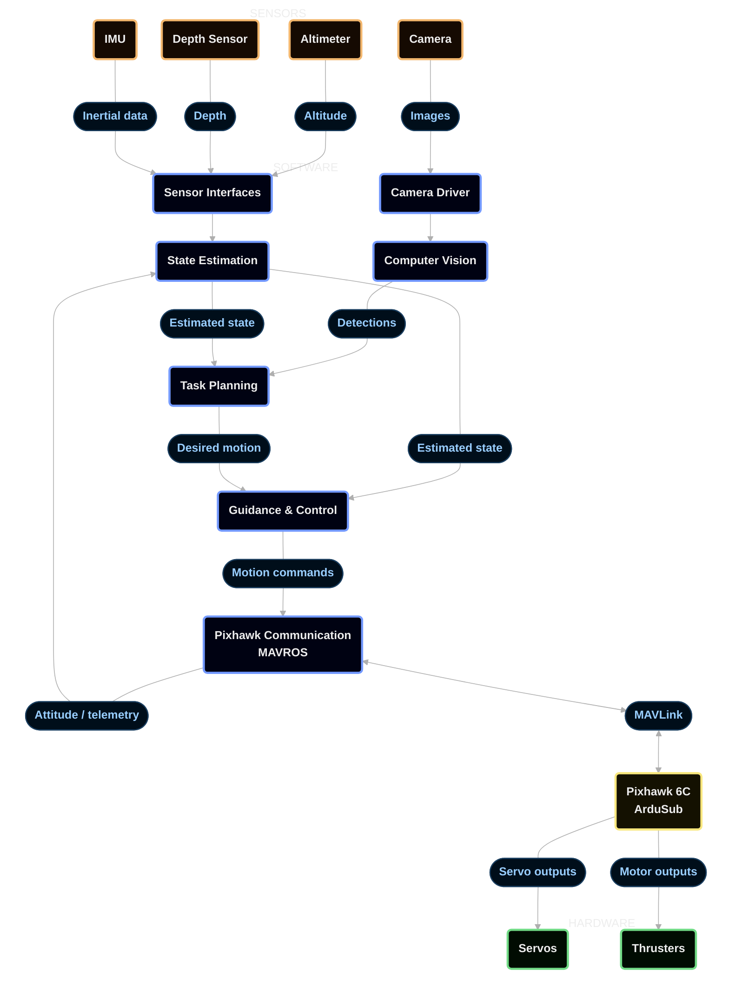

# Columbia RoboSub

  

CURC is a student organization of Columbia University that competes in multiple robotics competitions. Learn more about the team and our projects on our [website](https://columbiarobotics.club/).

This repository contains all the code needed to run and test the RoboSub team's AUVs ([our website](https://auv.columbiarobotics.club/)). It is built on the Jazzy Jalisco distrobution of [ROS 2](https://www.ros.org/).

## System Flow
- Orange → sensor
- Blue → package
- Yellow → intermediary hardware
- Green → actuators

## Setup

### Build Packages

### Run Code

## Visualization and Debugging

## Testing and Code Quality
